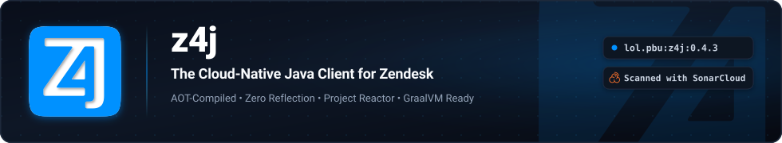

## About The Project
Built with Micronaut, z4j focuses on low memory use, fast startup, and native GraalVM support.

## Runtime Performance

Compared to traditional reflection-based clients like CloudBees:

* **Zero reflection:** Serialization is handled at compile time without runtime reflection caches.
* **Low memory overhead:** Lean execution across cloud containers, serverless workloads, and CLI tools.

### Memory Benchmark (CloudBees vs z4j)

Here are the memory allocation results when parsing Zendesk tickets into domain models:

| Ticket Cohort | Payload Size | CloudBees (Jackson AST + Reflection) | z4j (Compile-Time Serde Records) | z4j Memory Savings |
|:---|:---|:---|:---|:---|
| **25 Tickets** | 43 KB JSON | 50,344 KB (cold start) | 24,401 KB (cold start) | **52% less memory** |
| **50 Tickets** | 86 KB JSON | 1,661 KB | 520 KB | **69% less memory** |
| **100 Tickets** | 173 KB JSON | 3,799 KB | 1,035 KB | **73% less memory** |

Run the benchmark locally:

```bash
./gradlew benchmark
```

### Installation

**Gradle**

| Gradle Kotlin                                  | Gradle                                        |
|:-----------------------------------------------|:----------------------------------------------|
| <pre>implementation("lol.pbu:z4j:0.4.2")</pre> | <pre>implementation 'lol.pbu:z4j:0.4.2'</pre> |

**Maven**

```xml
<dependency>
	<groupId>lol.pbu</groupId>
	<artifactId>z4j</artifactId>
	<version>0.4.2</version>
</dependency>
```

## Working with View Conditions

A Zendesk view condition can hold different kinds of values: a word or ID, a list of tags, a true/false flag, or a whole number. `ViewConditionValue` keeps these values strongly typed so you do not have to cast an `Object`.

### Creating conditions

```java
// Plain text value (using the shortcut constructor)
var statusOpen = new ViewCondition("status", "is", "open");

// A list of tags
var vipTags = new ViewCondition(
        "current_tags",
        "includes",
        ViewConditionValue.of(List.of("vip", "enterprise")));

// A true/false flag
var isPublic = new ViewCondition("is_public", "is", ViewConditionValue.of(true));

// A whole number
var ticketId = new ViewCondition("ticket_id", "is", ViewConditionValue.of(24000932000L));
```

### Reading condition values

Use a Java `switch` to handle every kind of value safely:

```java
String describeValue(ViewCondition condition) {
    return switch (condition.value()) {
        case ViewConditionValue.Text(var text) -> "text: " + text;
        case ViewConditionValue.TextList(var tags) -> "tags: " + String.join(", ", tags);
        case ViewConditionValue.Flag(var flag) -> "flag: " + flag;
        case ViewConditionValue.Numeric(var number) -> "number: " + number;
        case null -> "no value";
    };
}
```

## Example Projects

- [zcmi]: Cross-platform CLI to manage Zendesk tickets and articles with automatic rate-limit backoff.
- [zenith]: MCP server bringing rate-safe Zendesk tools to AI agents on any platform.

## Contributing

[](https://sonarcloud.io/summary/new_code?id=PeanutButter-Unicorn_z4j)

Please read our [Code of Conduct](CODE_OF_CONDUCT.md) and [Contributing Guide](CONTRIBUTING.md) for details on our
development process, style guides, and testing strategy.

[Contributing Guide]:CONTRIBUTING.md#set-up-your-machine

[Micronaut]:https://graal.cloud/gdk/

[testing]:CONTRIBUTING.md#testing

[zcmi]:https://github.com/pbu-projects/zcmi

[zenith]:https://github.com/pbu-projects/zenith
